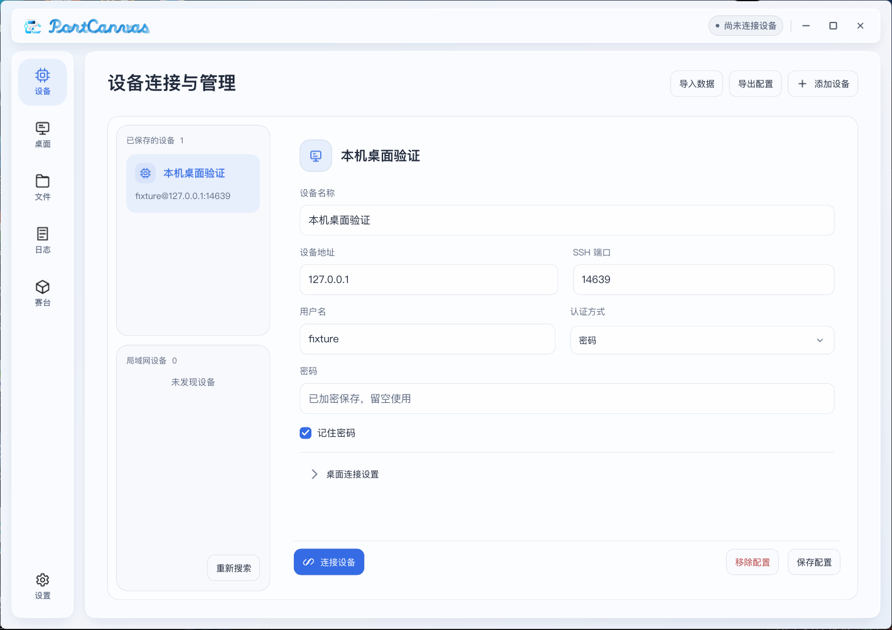
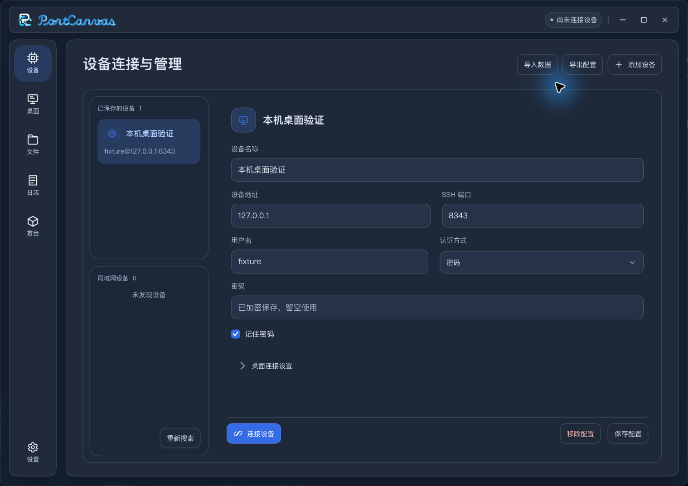
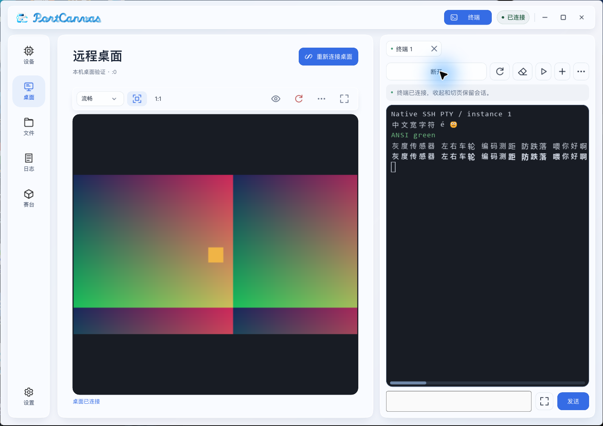

<div align="center">


<h1>PortCanvas</h1>

<p><strong>A fast, native Liquid Glass workbench for remote Linux devices</strong></p>

<p>
  Built with Rust &amp; Slint — combining SSH device management, remote desktop, dual-pane SFTP,<br>
  persistent multi-tab terminals, and live arena monitoring with zero WebView or Electron overhead.
</p>

<p>
  <a href="https://github.com/JvKan9Zz/PortCanvas/releases/tag/v0.6.4"></a>
  <a href="https://github.com/JvKan9Zz/PortCanvas/releases/tag/v0.6.3"></a>
  
  <a href="LICENSE"></a>
</p>

<p>
  <a href="README.md">简体中文</a> · <strong>English</strong>
  &nbsp;&nbsp;|&nbsp;&nbsp;
  <a href="https://github.com/JvKan9Zz/PortCanvas/releases/download/v0.6.4/PortCanvas_0.6.4_x64-setup.exe"><strong>Download Windows v0.6.4</strong></a>
  · <a href="https://github.com/JvKan9Zz/PortCanvas/releases/download/v0.6.3/PortCanvas_0.6.3_universal.dmg">macOS DMG</a>
  · <a href="docs/usage.md">Usage Guide</a>
  · <a href="https://github.com/JvKan9Zz/PortCanvas/releases">Releases</a>
</p>

<br>

<picture>
  <source media="(prefers-color-scheme: dark)" srcset="assets/preview/workbench-dark.png">
  <source media="(prefers-color-scheme: light)" srcset="assets/preview/workbench-light.png">
  
</picture>

</div>

---

## Why PortCanvas

- **100% Native Performance**: Powered by Rust, Slint (FemtoVG), native VT terminal emulation, native RFB remote desktop, and system media playback. No Electron, no WebView, and zero runtime prerequisites after installation.
- **Frameless Liquid Glass Design**: Windows v0.6.4 introduces a full-width floating glass header with native Win32 window chrome (drag, edge/corner resize, Snap, and auto-hide taskbar reveal), while macOS integrates native system materials. Glass quality (Full by default) and opacity are independently configurable with color, cropped image, or video backgrounds.
- **Uninterrupted Multi-Tool Workflow**: Keep one persistent `tmux`-backed terminal drawer docked on the right while moving seamlessly across Remote Desktop, SFTP Files, Local Logs, and Arena monitoring.
- **Built for Robotics & Embedded Linux**: LAN SSH discovery, per-device one-click program launchers, on-demand camera streaming with strict lifecycle teardown, live CPU/memory history, and an atomic external pose protocol.

---

## Features

| Area | Highlights |
| --- | --- |
| **Devices** | LAN SSH discovery, password or private-key auth, host fingerprint verification, OS-encrypted optional credential storage, staged connection progress, and `.portcanvas` config export/import with automatic backup |
| **Remote Desktop** | Native X11/RFB transport, three quality presets, Fit / `1:1` scaling, read-only mode, clipboard sync, and smooth in-window expansion |
| **Files (SFTP)** | Resizable dual-pane browser, multi-select drag-and-drop, recursive transfers, overwrite confirmation, bandwidth throttling, cancellation, and single-file full-path copy |
| **Terminals & Logs** | Scrollable multi-tab persistent `tmux` terminals, IME support, command drafts/history/completion, per-device program launch presets, and filterable local run logs with storage caps |
| **Arena & Camera** | On-demand remote camera preview (automatically released on page leave, minimize, disconnect, or exit), live device metrics, and [external pose input](docs/pose-protocol.md) |
| **Appearance** | Instant Chinese/English switching, Light / Dark / System themes, accent palettes, custom color/image/video backgrounds, and real-time Liquid Glass tuning |

---

## Preview

<table>
  <tr>
    <td width="50%">
      
      <p align="center"><sub>Dark Liquid Glass Workbench &amp; Frameless Header</sub></p>
    </td>
    <td width="50%">
      
      <p align="center"><sub>Remote Desktop with Resizable Shared Terminal Drawer</sub></p>
    </td>
  </tr>
</table>

---

## Download & Install

| Platform | Latest | Package | Notes |
| --- | --- | --- | --- |
| **Windows x64** | **v0.6.4** | [**PortCanvas_0.6.4_x64-setup.exe**](https://github.com/JvKan9Zz/PortCanvas/releases/download/v0.6.4/PortCanvas_0.6.4_x64-setup.exe) | Stable channel with signed in-app updates; fresh installs store data in `<install>/data/`, upgrades keep existing data |
| **macOS 13.0+** | **v0.6.3** | [**PortCanvas_0.6.3_universal.dmg**](https://github.com/JvKan9Zz/PortCanvas/releases/download/v0.6.3/PortCanvas_0.6.3_universal.dmg) | Apple Silicon &amp; Intel Universal build, ad-hoc signed for manual install; see [Mac guide](docs/macos.md) |

<details>
<summary><strong>Data migration, remote dependencies &amp; archive links</strong></summary>

- **Credentials & Migration**: Saved credentials stay encrypted on the local machine via Windows DPAPI or macOS Keychain and are never exported inside `.portcanvas` bundles. Legacy data and `.portcanvas` bundles can be previewed and imported from the Devices page with automatic backup.
- **Remote Linux Tools**: Reuses existing SSH, Python 3, `tmux`, SFTP, `x11vnc`, and FFmpeg/OpenCV on the target device. Optional component preparation targets Ubuntu 20.04 ARM64 controllers inside an isolated user cache without modifying system SDKs.
- **Previous Releases**: [Windows v0.5.95](https://github.com/JvKan9Zz/PortCanvas/releases/tag/v0.5.95) · [macOS v0.5.95](https://github.com/JvKan9Zz/PortCanvas/releases/tag/v0.5.95) · [All Releases](https://github.com/JvKan9Zz/PortCanvas/releases)

</details>

---

## Build from Source & Repository Map

Requires Rust 1.90+, Git Bash, and Visual Studio C++ Build Tools (Windows) or Xcode (macOS):

```bash
# Windows x64 static-CRT release build
cd app && bash tools/build-native.sh
```

| Path | Description |
| --- | --- |
| [app/](app/README.md) | Native Rust / Slint workspace (`core` services + `native-probe` workbench), tests & packaging tools |
| [assets/](assets) | Brand artwork, README UI previews & arena assets |
| [docs/usage.md](docs/usage.md) | Full user guide (Chinese) |
| [docs/macos.md](docs/macos.md) | macOS Universal build & installation guide |
| [docs/pose-protocol.md](docs/pose-protocol.md) | External arena pose protocol |
| [docs/security.md](docs/security.md) | Authentication, encryption, signed updates & data boundaries |

---

## License

Released under the [MIT License](LICENSE). Third-party crates, fonts, and Slint remain under their respective licenses; see [THIRD-PARTY-NOTICES.md](app/native-probe/THIRD-PARTY-NOTICES.md).
