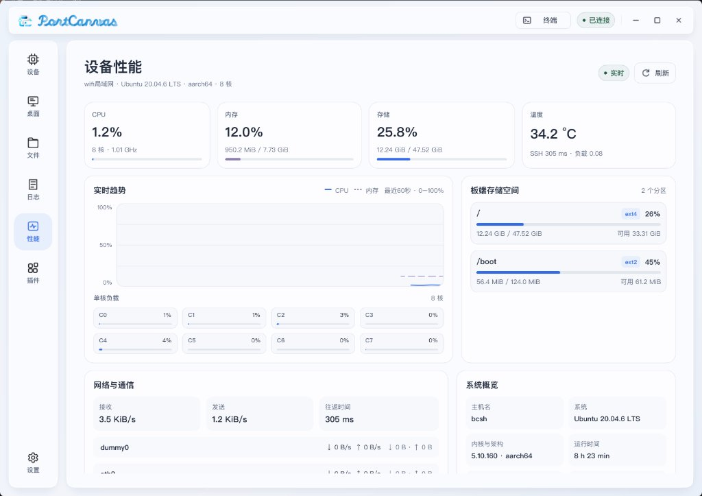
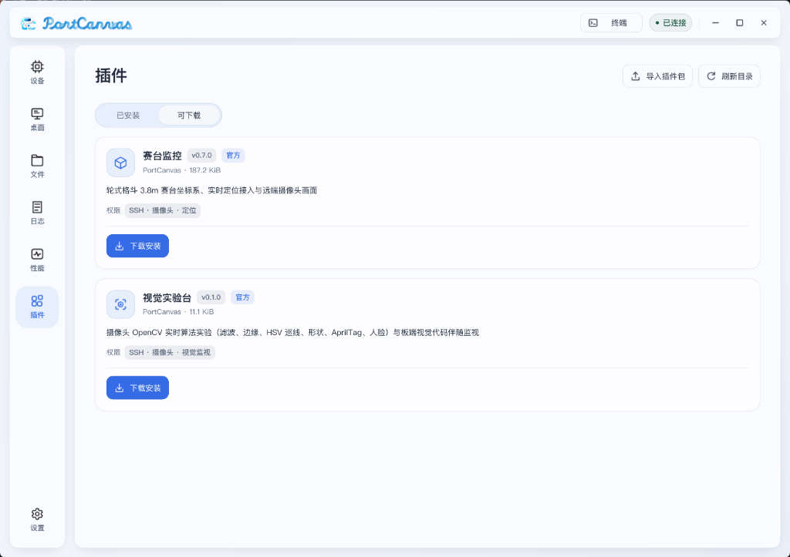
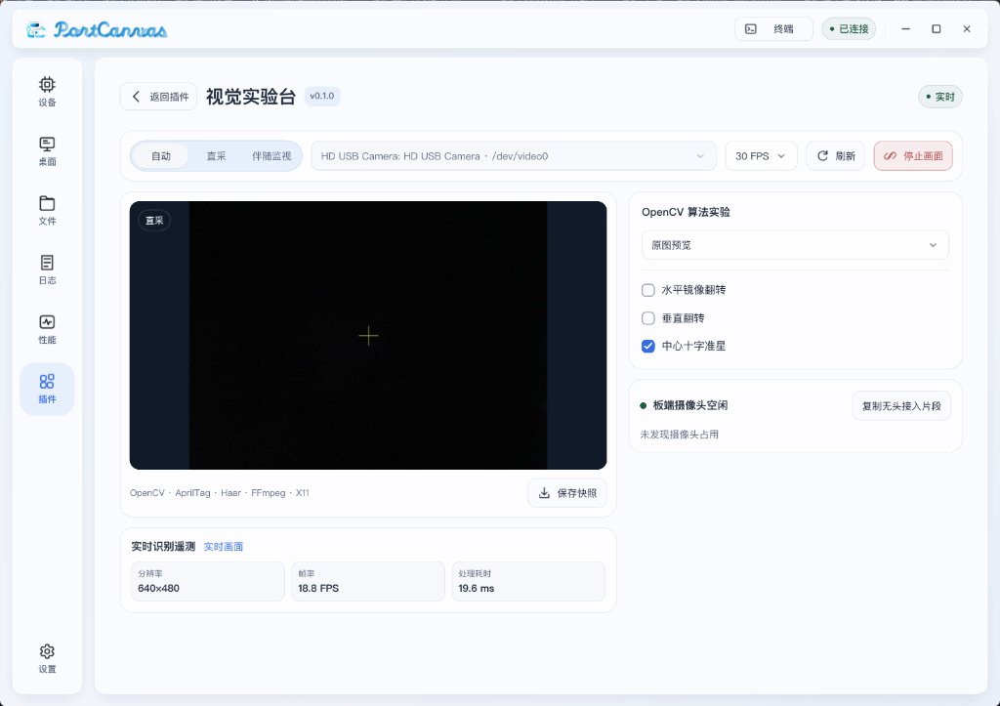

<div align="center">


<h1>PortCanvas</h1>

<p><strong>A fast, native Liquid Glass workbench for remote Linux devices</strong></p>

<p>
  Built with Rust &amp; Slint — combining SSH device management, remote desktop, dual-pane SFTP,<br>
  persistent multi-tab terminals, live hardware telemetry, and a signed plugin ecosystem with zero WebView overhead.
</p>

<p>
  <a href="https://github.com/JvKan9Zz/PortCanvas/releases/tag/v0.7.2"></a>
  <a href="https://github.com/JvKan9Zz/PortCanvas/releases/tag/v0.7.2"></a>
  
  <a href="LICENSE"></a>
</p>

<p>
  <a href="README.md">简体中文</a> · <strong>English</strong>
  &nbsp;&nbsp;|&nbsp;&nbsp;
  <a href="https://github.com/JvKan9Zz/PortCanvas/releases/download/v0.7.2/PortCanvas_0.7.2_x64-setup.exe"><strong>Download Windows v0.7.2</strong></a>
  · <a href="https://github.com/JvKan9Zz/PortCanvas/releases/download/v0.7.2/PortCanvas_0.7.2_universal.dmg">macOS v0.7.2 DMG</a>
  · <a href="docs/usage.md">Usage Guide</a>
  · <a href="docs/plugin-development.md">Plugin Dev Spec</a>
  · <a href="https://github.com/JvKan9Zz/PortCanvas/releases">Releases</a>
</p>

<br>


</div>

---

## Why PortCanvas

- **100% Native Performance**: Powered by Rust, Slint (FemtoVG), native VT terminal emulation, native RFB remote desktop, and system media playback. No Electron, no WebView, and zero runtime prerequisites after installation.
- **Frameless Liquid Glass Design**: Windows uses a full-width floating glass header with native Win32 window chrome (drag, edge/corner resize, Snap, and auto-hide taskbar reveal), while macOS integrates native system materials. Glass quality (Full by default) and opacity are independently configurable with color, cropped image, or video backgrounds.
- **Dedicated Device Monitor**: Promoted into a standalone Monitor page delivering 60-second CPU/memory curves, per-core load & clock speed, storage/disk usage across mount points, per-interface network rates & RTT, multi-zone thermals, and system overview.
- **Toolbox & Declarative Native Plugin Engine**: Built on a pure Rust + Slint `declarative-v1` UI engine and `pc-worker-v1` local worker protocol (zero WebView). Brand-new tool categories can ship independently via the HTTPS + Minisign-verified catalog without updating the host binary, or be imported offline via the **Upload Plugin** dialog (which also exports the offline developer spec). Installed plugins live cleanly in `<install>/plugins/` on Windows (and `<data>/plugins/` on macOS).
- **Uninterrupted Multi-Tool Workflow**: Keep one persistent `tmux`-backed terminal drawer docked on the right while moving seamlessly across Remote Desktop, SFTP Files, Local Logs, Device Monitor, and Toolbox plugin workspaces.

---

## Features

| Area | Highlights |
| --- | --- |
| **Devices** | LAN SSH discovery, password or private-key auth, host fingerprint verification, OS-encrypted optional credential storage, staged connection progress, and `.portcanvas` config export/import with automatic backup |
| **Remote Desktop** | Native X11/RFB transport, three quality presets, Fit / `1:1` scaling, read-only mode, clipboard sync, and smooth in-window expansion |
| **Files (SFTP)** | Resizable dual-pane browser, multi-select drag-and-drop, recursive transfers, overwrite confirmation, bandwidth throttling, cancellation, and single-file full-path copy |
| **Terminals & Logs** | Scrollable multi-tab persistent `tmux` terminals, IME support, command drafts/history/completion, per-device program launch presets, and filterable local run logs with storage caps |
| **Device Monitor** | Live 2-second telemetry (auto-stopped on leave, hide, or disconnect): 4 KPI cards, 60s dual trend chart, per-core CPU & frequency, disk storage breakdown, per-NIC throughput & RTT, thermals, and OS/kernel facts |
| **Toolbox (Plugins)** | Pure native declarative plugin engine with concurrent Minisign-verified downloads, Upload Plugin dialog (local `.pcplugin` import + offline spec download), background workers, and permission confirmation; ships with **Arena Monitor (`v0.8.0`)**, **Vision Studio (`v0.2.0`)**, **Video Capture (`v0.1.0`)**, and **128-Thread Downloader (`v0.1.0`)** |
| **Appearance** | Instant Chinese/English switching, Light / Dark / System themes, accent palettes, custom color/image/video backgrounds, and real-time Liquid Glass tuning |

---

## Official Plugins (Toolbox)

Open **Toolbox (Plugins) → Available** inside PortCanvas to download signed official plugins directly, or click **Upload Plugin** to import `.pcplugin` bundles offline or save the offline plugin development guide:

| Plugin | Version | Platforms | Description |
| --- | --- | --- | --- |
| **Arena Monitor** (`arena-monitor`) | `v0.8.0` | Cross-platform | 3.8m combat arena map, live robot pose telemetry (coordinates, heading, confidence, latency via [pose protocol](docs/pose-protocol.md)), and on-demand remote camera preview |
| **Vision Studio** (`vision-studio`) | `v0.2.0` | Cross-platform | Live OpenCV camera lab with 7 hot-swappable pipelines and **board camera companion watch** (`/dev/video*` process inspection, X11 OpenCV window capture, and `/dev/shm/portcanvas_cam.jpg` shared-frame streaming) |
| **Video Capture** (`video-capture`) | `v0.1.0` | Windows x64 | Zero-overhead native USB / HDMI capture card & webcam viewer (Windows MediaFoundation) with resolution/FPS switching, Fit/Fill/`1:1`, 0°/90°/180°/270° rotation, H/V flip, and PNG snapshots — works locally without a remote device |
| **128-Thread Downloader** (`fast-downloader`) | `v0.1.0` | Windows x64 · macOS Universal | Background multi-task download queue with 8/32/64/128 threads (default 128, automatic single-thread fallback when Range is unsupported), pause/resume across restarts, system proxy inheritance, and custom save folder; **automatically replaces PortCanvas's built-in 32-thread downloader when enabled and reverts on uninstall/disable** |

---

## Preview

<table>
  <tr>
    <td width="50%">
      
      <p align="center"><sub>Standalone Device Performance Monitor (Trends, Per-Core, Storage, Network &amp; System)</sub></p>
    </td>
    <td width="50%">
      
      <p align="center"><sub>Signed Downloadable Plugins (Arena Monitor &amp; Vision Studio)</sub></p>
    </td>
  </tr>
  <tr>
    <td width="50%">
      
      <p align="center"><sub>Vision Studio Plugin: Live OpenCV Tuning &amp; Board Camera Companion Watch</sub></p>
    </td>
    <td width="50%">
      
      <p align="center"><sub>Remote Desktop with Resizable Shared Terminal Drawer</sub></p>
    </td>
  </tr>
</table>

---

## Download & Install

| Platform | Latest | Package | Notes |
| --- | --- | --- | --- |
| **Windows x64** | **v0.7.2** | [**PortCanvas_0.7.2_x64-setup.exe**](https://github.com/JvKan9Zz/PortCanvas/releases/download/v0.7.2/PortCanvas_0.7.2_x64-setup.exe) | Stable channel with signed in-app updates; fresh installs store data in `<install>/data/`, plugins in `<install>/plugins/`, and silent 10 MiB diagnostic logs in `<install>/debuglogs/`; upgrades keep existing data |
| **macOS 13.0+** | **v0.7.2** | [**PortCanvas_0.7.2_universal.dmg**](https://github.com/JvKan9Zz/PortCanvas/releases/download/v0.7.2/PortCanvas_0.7.2_universal.dmg) | Apple Silicon &amp; Intel Universal build, ad-hoc signed for manual install ([SHA-256](https://github.com/JvKan9Zz/PortCanvas/releases/download/v0.7.2/PortCanvas_0.7.2_universal.dmg.sha256)); see [Mac guide](docs/macos.md) |

<details>
<summary><strong>Data migration, remote dependencies &amp; archive links</strong></summary>

- **Credentials & Migration**: Saved credentials stay encrypted on the local machine via Windows DPAPI or macOS Keychain and are never exported inside `.portcanvas` bundles. Legacy data and `.portcanvas` bundles can be previewed and imported from the Devices page with automatic backup.
- **Updates, Diagnostics & Plugin Trust**: Windows stable builds support Minisign-verified in-app updates and one-click debug log export ("Report Issue") via Settings → About. Production builds enforce HTTPS and Minisign verification for the plugin catalog.
- **Remote Linux Tools**: Reuses existing SSH, Python 3, `tmux`, SFTP, `x11vnc`, and FFmpeg/OpenCV on the target device. Optional component preparation targets Ubuntu 20.04 ARM64 controllers inside an isolated user cache without modifying system SDKs.
- **Previous Releases**: [v0.7.1](https://github.com/JvKan9Zz/PortCanvas/releases/tag/v0.7.1) · [v0.7.0](https://github.com/JvKan9Zz/PortCanvas/releases/tag/v0.7.0) · [v0.6.4](https://github.com/JvKan9Zz/PortCanvas/releases/tag/v0.6.4) · [v0.6.3](https://github.com/JvKan9Zz/PortCanvas/releases/tag/v0.6.3) · [v0.6.2](https://github.com/JvKan9Zz/PortCanvas/releases/tag/v0.6.2) · [All Releases](https://github.com/JvKan9Zz/PortCanvas/releases)

</details>

---

## Build from Source & Repository Map

Requires Rust 1.90+, Git Bash, and Visual Studio C++ Build Tools (Windows) or Xcode (macOS):

```bash
# Windows x64 static-CRT release build
cd app && bash tools/build-native.sh
```

| Path | Description |
| --- | --- |
| [app/](app/README.md) | Native Rust / Slint workspace (`core` services + `native-probe` workbench), tests & packaging tools |
| [plugins/](plugins) | Official plugin sources (`arena-monitor`, `vision-studio`, `video-capture`, `fast-downloader`), `_template` starter, and signed `catalog.json` |
| [assets/](assets) | Brand artwork & README UI previews |
| [docs/usage.md](docs/usage.md) | Full user guide (Chinese) |
| [docs/plugin-development.md](docs/plugin-development.md) | Declarative native plugin development spec (`declarative-v1` & `pc-worker-v1`) |
| [docs/macos.md](docs/macos.md) | macOS Universal build & installation guide |
| [docs/pose-protocol.md](docs/pose-protocol.md) | External arena pose protocol |
| [docs/security.md](docs/security.md) | Authentication, encryption, signed updates & data boundaries |

---

## License

Released under the [MIT License](LICENSE). Third-party crates, fonts, and Slint remain under their respective licenses; see [THIRD-PARTY-NOTICES.md](app/native-probe/THIRD-PARTY-NOTICES.md).
