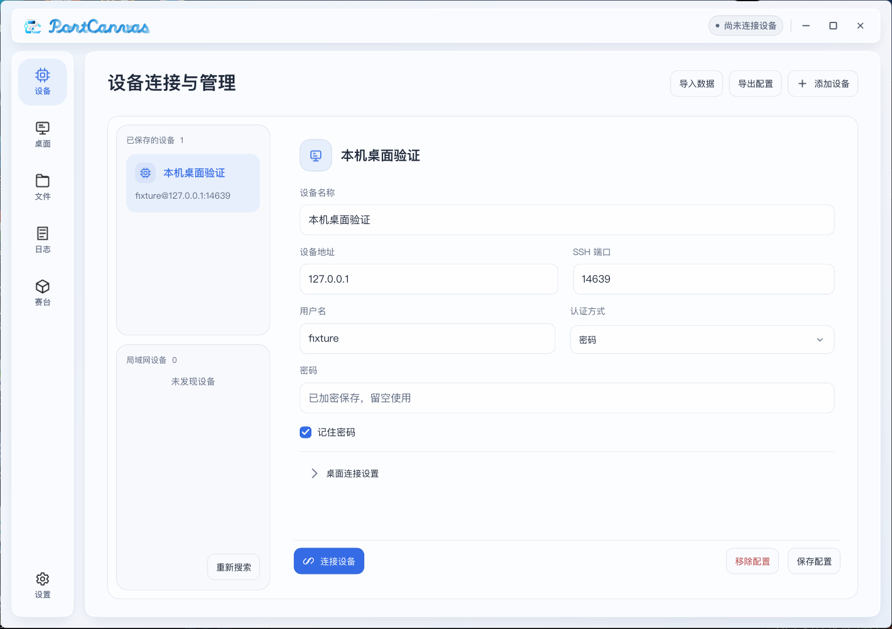
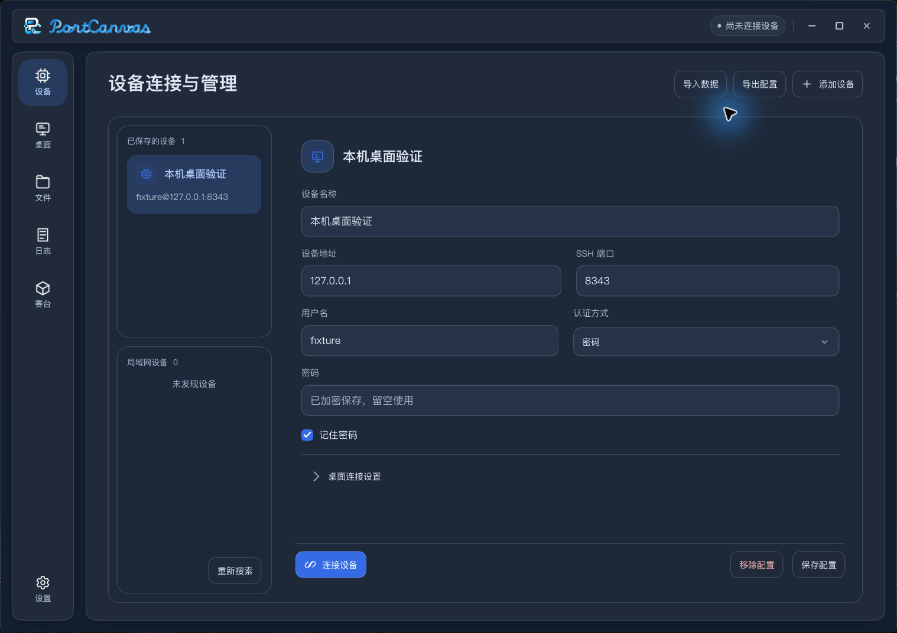
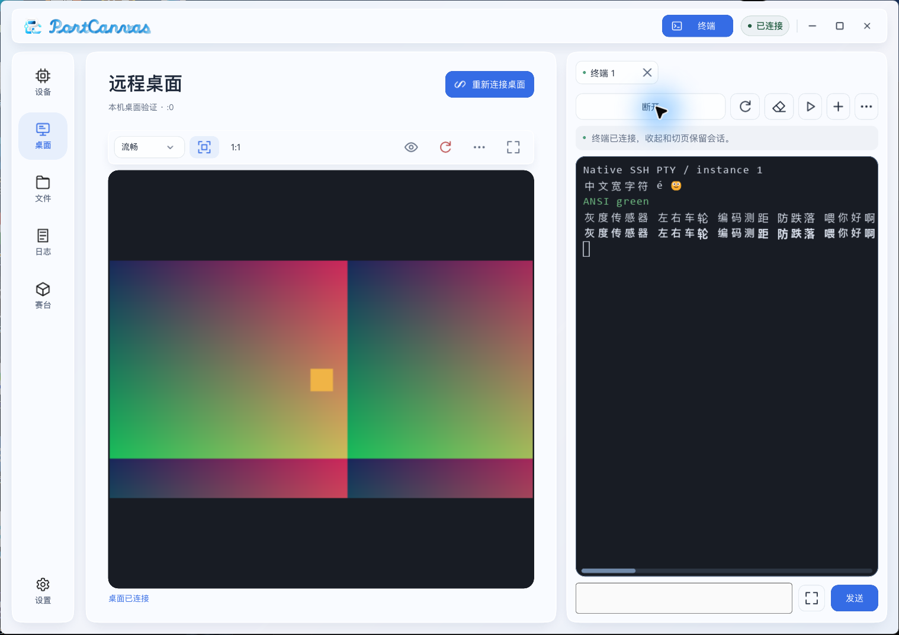

<div align="center">


<h1>PortCanvas</h1>

<p><strong>轻量、低延迟的液态玻璃原生远程设备工作台</strong></p>

<p>
  纯 Rust + Slint 原生桌面应用 · 集成 SSH 设备管理、远程桌面、双栏 SFTP、持久多终端与赛台监控<br>
  无 Electron / WebView 拖累，开箱即用，零外部运行时依赖
</p>

<p>
  <a href="https://github.com/JvKan9Zz/PortCanvas/releases/tag/v0.6.4"></a>
  <a href="https://github.com/JvKan9Zz/PortCanvas/releases/tag/v0.6.3"></a>
  
  <a href="LICENSE"></a>
</p>

<p>
  <strong>简体中文</strong> · <a href="README.en.md">English</a>
  &nbsp;&nbsp;|&nbsp;&nbsp;
  <a href="https://github.com/JvKan9Zz/PortCanvas/releases/download/v0.6.4/PortCanvas_0.6.4_x64-setup.exe"><strong>下载 Windows v0.6.4</strong></a>
  · <a href="https://github.com/JvKan9Zz/PortCanvas/releases/download/v0.6.3/PortCanvas_0.6.3_universal.dmg">macOS DMG</a>
  · <a href="docs/usage.md">使用说明</a>
  · <a href="https://github.com/JvKan9Zz/PortCanvas/releases">更新日志</a>
</p>

<br>

<picture>
  <source media="(prefers-color-scheme: dark)" srcset="assets/preview/workbench-dark.png">
  <source media="(prefers-color-scheme: light)" srcset="assets/preview/workbench-light.png">
  
</picture>

</div>

---

## 设计理念与亮点

- **全链路原生架构**：基于 Rust、Slint（FemtoVG）、原生 VT 终端、原生 RFB 远程桌面与系统级媒体解码构建，彻底告别浏览器壳与高内存占用，安装后无需 Node.js、Rust 或 Python 环境。
- **无边框液态玻璃体验**：Windows v0.6.4 采用自绘贯通浮岛顶栏与原生 Win32 交互（支持拖动、四边缩放、贴边分屏与自动隐藏任务栏唤出）；macOS 适配系统原生材质；支持独立调节玻璃质量（默认 Full）与工作区不透明度，并支持纯色、裁剪图片与动态视频背景。
- **一处连接，处处协同**：左侧导航浮岛配合右侧可拖拽共享终端抽屉，在查看远程桌面、传输文件、翻阅日志或调试赛台时，随时拉出同一组持久化 `tmux` 终端，不打断当前工作流。
- **为机器人与嵌入式 Linux 控制器实战打造**：支持局域网 SSH 自动发现、按设备保存一键启动程序、按需远端相机预览、设备 CPU/内存实时曲线，以及标准外部定位协议接入。

---

## 核心功能

| 模块 | 能力一览 |
| --- | --- |
| **设备连接** | 局域网 SSH 自动发现、密码 / 私钥认证、主机指纹核对、本机加密保存凭据、分阶段连接进度与随时取消；支持 `.portcanvas` 配置包导入导出与导入前自动备份 |
| **远程桌面** | 原生 X11 / RFB 连接，提供流畅 / 清晰 / 省资源三档画质、适配窗口与 `1:1` 缩放、只读模式、双向剪贴板，以及保留工具栏的窗口内无缝展开 |
| **文件管理** | 可调双栏 SFTP，支持多选与拖拽传输、递归目录上传/下载、覆盖确认、限速、随时取消、远端删除，以及单文件完整路径一键复制 |
| **终端与日志** | 多标签可滚动终端、持久 `tmux` 会话、中文输入法与命令草稿/历史/补全、按设备配置一键启动程序；本机运行日志支持项目/日期筛选、详情面板调节与自动上限清理 |
| **赛台监控** | 按需开启远端相机预览（离页、最小化、断连与退出自动回收采集）、设备性能历史曲线与外部定位输入接口（详见 [定位协议](docs/pose-protocol.md)） |
| **个性与外观** | 中英文实时切换、浅色 / 深色 / 跟随系统、多套主题强调色、纯色 / 图片裁剪 / 视频背景与音量调节，以及实时预览的玻璃材质参数 |

---

## 界面预览

<table>
  <tr>
    <td width="50%">
      
      <p align="center"><sub>深色液态玻璃工作台与无边框贯通顶栏</sub></p>
    </td>
    <td width="50%">
      
      <p align="center"><sub>远程桌面与右侧可调宽共享持久终端</sub></p>
    </td>
  </tr>
</table>

---

## 下载与安装

| 平台 | 最新版本 | 安装包 | 说明 |
| --- | --- | --- | --- |
| **Windows x64** | **v0.6.4** | [**PortCanvas_0.6.4_x64-setup.exe**](https://github.com/JvKan9Zz/PortCanvas/releases/download/v0.6.4/PortCanvas_0.6.4_x64-setup.exe) | 稳定通道，内置签名自动更新；新装资料保存在安装目录 `data/`，原地升级沿用既有资料 |
| **macOS 13.0+** | **v0.6.3** | [**PortCanvas_0.6.3_universal.dmg**](https://github.com/JvKan9Zz/PortCanvas/releases/download/v0.6.3/PortCanvas_0.6.3_universal.dmg) | Apple Silicon & Intel 通用包，采用 ad-hoc 签名手动安装，详见 [Mac 安装说明](docs/macos.md) |

<details>
<summary><strong>资料迁移、软件内更新与历史版本说明</strong></summary>

- **配置迁移与备份**：在「设备」页点击「导入数据」，可预览并导入 `.portcanvas` 配置包或旧版资料，导入前自动创建备份。本机加密凭据采用 Windows DPAPI / macOS Keychain 保护，导出配置包时不会携带密码和私钥。
- **自动更新**：Windows 正式版可在「设置 → 关于」检查并完成经 Minisign 签名校验的稳定通道更新。
- **远端 Linux 依赖**：板端按需复用已有的 SSH、Python 3、`tmux`、SFTP、`x11vnc`、FFmpeg / OpenCV；缺失组件可由电脑下载并通过 SSH 放入用户隔离缓存（当前自动准备面向 Ubuntu 20.04 ARM64 控制器），不替换系统 SDK 或已有程序。
- **历史归档**：[Windows v0.5.95](https://github.com/JvKan9Zz/PortCanvas/releases/tag/v0.5.95) · [macOS v0.5.95](https://github.com/JvKan9Zz/PortCanvas/releases/tag/v0.5.95) · [全部 Releases](https://github.com/JvKan9Zz/PortCanvas/releases)

</details>

---

## 源码构建与项目结构

需要 Rust 1.90+、Git Bash 与 Visual Studio C++ Build Tools（Windows）或 Xcode（macOS）：

```bash
# Windows x64 静态 CRT 发布构建
cd app && bash tools/build-native.sh
```

| 路径 | 说明 |
| --- | --- |
| [app/](app/README.md) | Rust / Slint 原生工程（`core` 共享服务 + `native-probe` 工作台）、测试与打包脚本 |
| [assets/](assets) | 品牌图标、界面预览图与赛台原件 |
| [docs/usage.md](docs/usage.md) | 完整功能与日常使用指南 |
| [docs/macos.md](docs/macos.md) | macOS Universal 构建与安装指南 |
| [docs/pose-protocol.md](docs/pose-protocol.md) | 赛台外部定位输入协议 |
| [docs/security.md](docs/security.md) | 认证、凭据加密、签名更新与数据边界说明 |

---

## 开源许可

本项目代码采用 [MIT License](LICENSE) 开源。第三方依赖、字体与 Slint 遵循各自协议条款，详见 [第三方组件声明](app/native-probe/THIRD-PARTY-NOTICES.md)。
